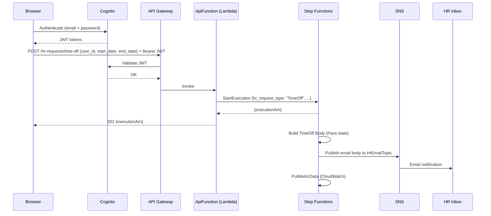
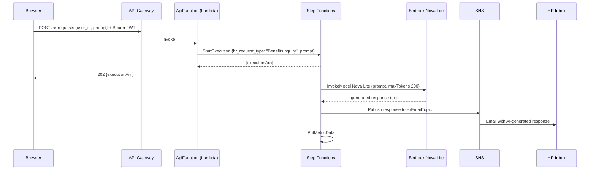
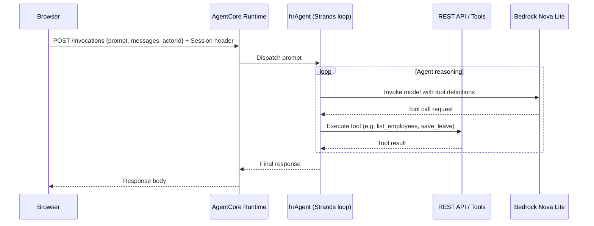

# Architecture

## System Overview

HR Leave Portal is a serverless, multi-stack AWS application built with AWS CDK (Python). The system has three deployed CDK stacks and two partially-built components (UI and hrAgent) that will become a fourth stack and a deployed AgentCore endpoint.

## Architectural Style

**Serverless / Event-driven** — AWS Lambda for compute, API Gateway for HTTP routing, Step Functions for workflow orchestration, DynamoDB for storage, SNS for notifications, Bedrock for LLM inference, and AgentCore for the AI agent runtime.

Evidence: `hr_leave_portal/backend_stack.py`, `hr_leave_portal/state_machine_stack.py`, `hr_leave_portal/notification_stack.py`, `state_machines/hr_state_machine_definition.json`.

## Component Relationships

```
┌─────────────────────────────────────────────────────────────┐
│  Client (Browser)                                            │
│  React SPA (ui/) — blank scaffold, to be built              │
│  aws-amplify ^6.22.2 + @aws-amplify/ui-react ^6.15.7       │
└────────┬──────────────────────────────┬──────────────────────┘
         │  HTTPS (JWT)                 │  HTTPS (AgentCore)
         ▼                              ▼
┌─────────────────────┐      ┌────────────────────────────────┐
│  API Gateway        │      │  AgentCore Runtime             │
│  (LambdaRestApi)    │      │  POST /invocations             │
│  Cognito Authorizer │      │  (bedrock_agentcore SDK)       │
└────────┬────────────┘      └────────────┬───────────────────┘
         │                               │
         ▼                               ▼
┌─────────────────────┐      ┌────────────────────────────────┐
│  ApiFunction        │      │  hrAgent (Strands)             │
│  (Lambda Python 3.14│      │  model: Nova Lite v1           │
│  FastAPI + Mangum)  │      │  SOURCE FILES ABSENT FROM REPO │
│  api/handler.py     │      │  tools recovered from OTLP     │
└──────┬──────────────┘      └────────────────────────────────┘
       │
       ├──────────────────────────────────────────────┐
       ▼                                              ▼
┌─────────────────────┐                   ┌──────────────────────┐
│  DynamoDB (HrTable) │                   │  Step Functions      │
│  PK/SK: USER/<id>   │                   │  (HrStateMachine)    │
│  PK/SK: <id>/<date> │                   │  ASL with JSONata    │
│  GSI1 (unused)      │                   └────────┬─────────────┘
└─────────────────────┘                            │
                                          ┌────────┴──────────────┐
                                          │                       │
                                          ▼                       ▼
                                 ┌────────────────┐   ┌─────────────────────┐
                                 │ SNS Topic      │   │ Bedrock Nova Lite   │
                                 │ (HrEmailTopic) │   │ us.amazon.nova-     │
                                 │ → hr@example   │   │ 2-lite-v1:0         │
                                 └────────────────┘   └─────────────────────┘
```

Text fallback: The React SPA calls API Gateway (authenticated with Cognito JWT) which forwards to the ApiFunction Lambda. The Lambda reads/writes DynamoDB and can start Step Functions executions. The state machine routes to either SNS (time-off) or Bedrock (general enquiry) before publishing to SNS. The hrAgent runs as a separate AgentCore runtime endpoint; its source is not in the repository.

## Data Flow

1. **Employee/leave CRUD**: Browser → API Gateway → ApiFunction Lambda → DynamoDB.
2. **Time-off request**: Browser → API Gateway → ApiFunction → Step Functions → `Build TimeOff Body` → SNS → HR email.
3. **General HR request**: Browser → API Gateway → ApiFunction → Step Functions → Bedrock Nova Lite → SNS → HR email.
4. **AI assistant conversation**: Browser → AgentCore `/invocations` → hrAgent (Strands loop) → hrAgent tools (which call the FastAPI backend or Bedrock) → response to browser.

## Key Design Decisions

- **Three CDK stacks with explicit cross-stack references**: `NotificationStack` owns the SNS topic; `BackendStack` owns the Lambda and API Gateway; `StateMachineStack` receives both and wires the state machine ARN back into the Lambda via `add_environment`. This keeps blast radius small — notification config is independent of compute.
- **Lambda layer for FastAPI dependencies**: `scripts/build_layer.sh` is run out-of-band before CDK deploy; the layer ARN is stored in SSM. This avoids bundling Python dependencies into the function zip and keeps function cold-start small.
- **Cognito `user_password` auth with no client secret**: suitable for a browser SPA where `aws-amplify` handles the auth flow without a server-side secret.
- **Step Functions JSONata**: the ASL definition uses `QueryLanguage: JSONata` for field extraction — a 2024+ Step Functions feature; not all tooling or SDKs support this.
- **AgentCore runtime for the AI agent**: the hrAgent is deployed as a Bedrock AgentCore endpoint, separate from the REST API. Integration from the UI requires either direct AgentCore invocation (via Amplify + Cognito identity credentials) or an API Gateway proxy.

## Improvement Opportunities

- CORS is `allow_origins=["*"]` — must be scoped to the CloudFront/Amplify Hosting URL once the UI stack is deployed.
- `HR_STATE_MACHINE_ARN` is read at module import in `hr_request_service.py` — any Lambda invocation without this env var will crash on cold start.
- `RemovalPolicy.DESTROY` on DynamoDB and Cognito — dangerous for staging/production environments.
- The DynamoDB GSI1 is defined but never queried.
- No CI/CD pipeline.

## Interaction Diagrams

### 1. Employee submits a time-off request



Text fallback: Browser authenticates with Cognito, POSTs to /hr-requests/time-off with a JWT, API Gateway validates the token, Lambda starts a Step Functions execution, returns 202 immediately, then Step Functions builds the message, publishes to SNS, and puts a CloudWatch metric.

### 2. Employee sends a general HR enquiry



Text fallback: Similar to time-off but the state machine routes to Bedrock Nova Lite to generate a response before publishing to SNS.

### 3. AI assistant conversation (hrAgent via AgentCore)



Text fallback: The browser POSTs to the AgentCore /invocations endpoint. AgentCore dispatches to the hrAgent's Strands loop, which iterates: asks Bedrock which tool to call, calls the tool (e.g. a REST API or email function), feeds the result back, until the model returns a final answer.
